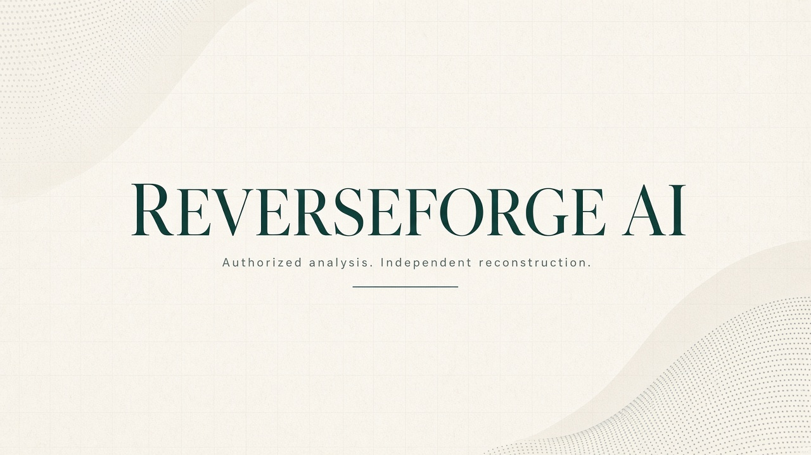
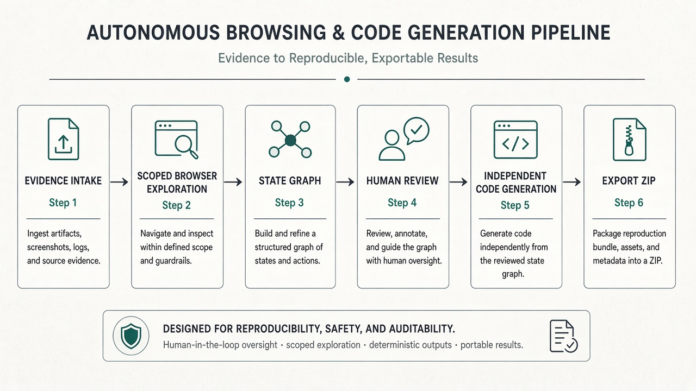
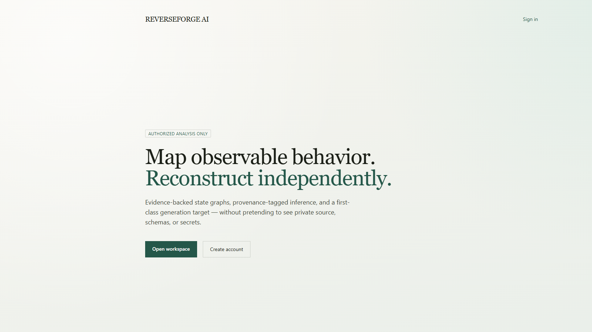
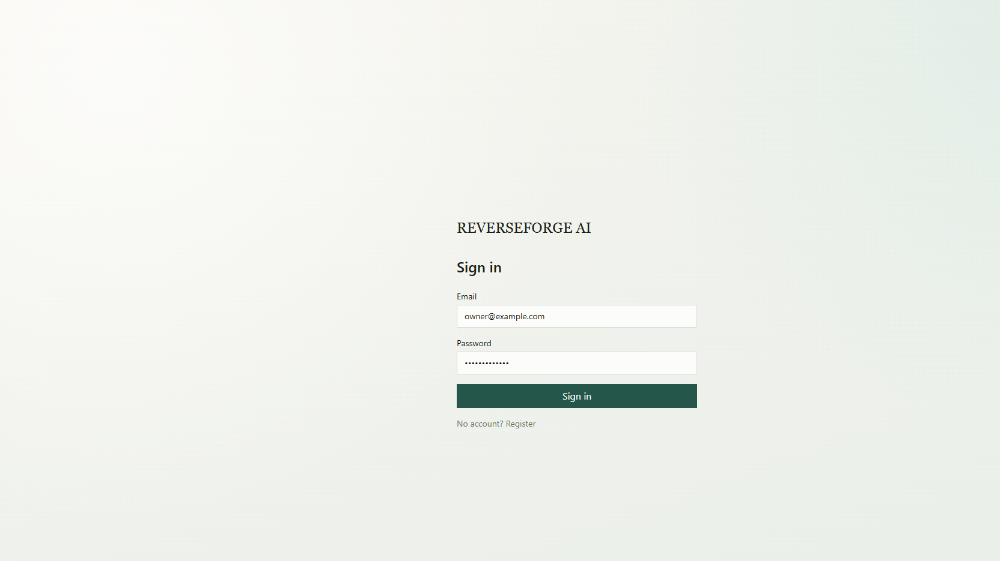
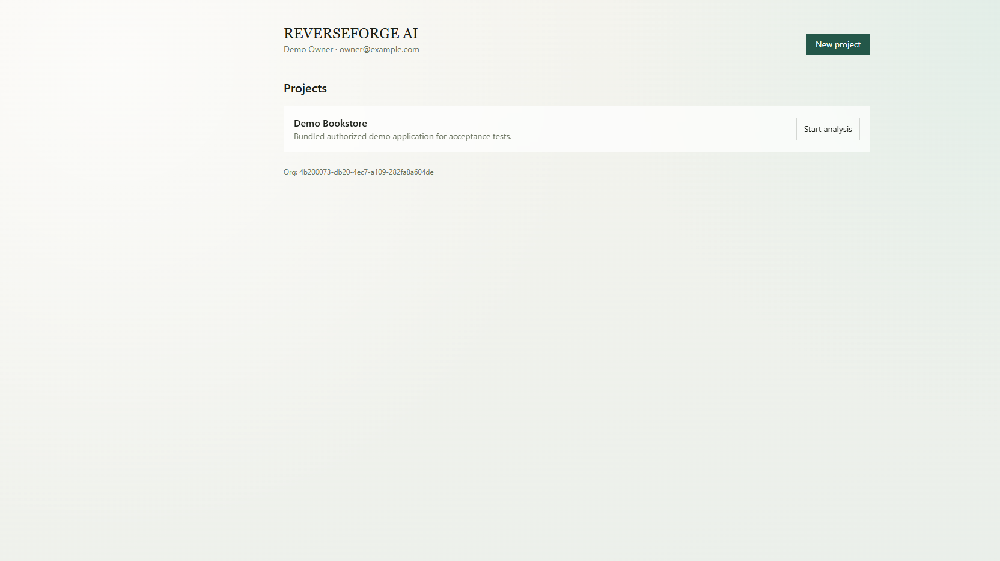
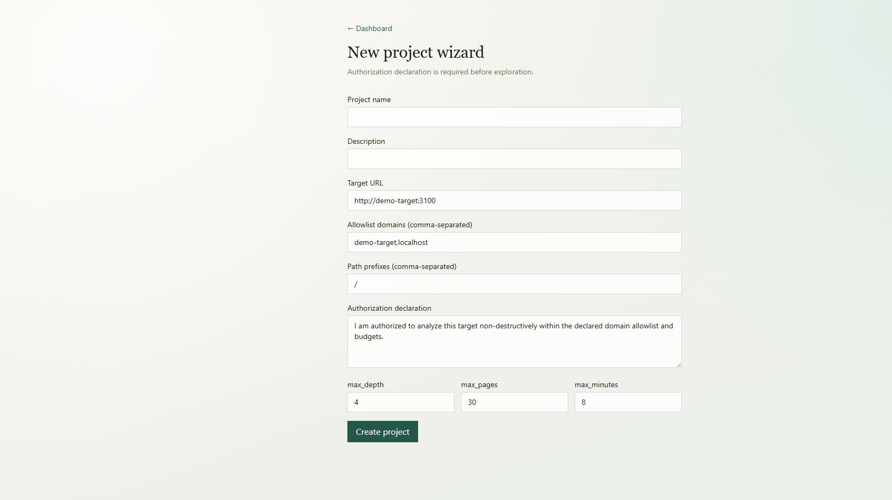
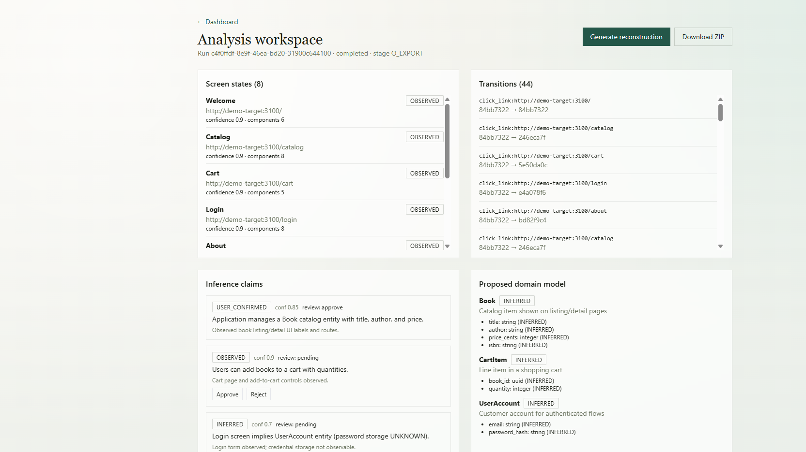
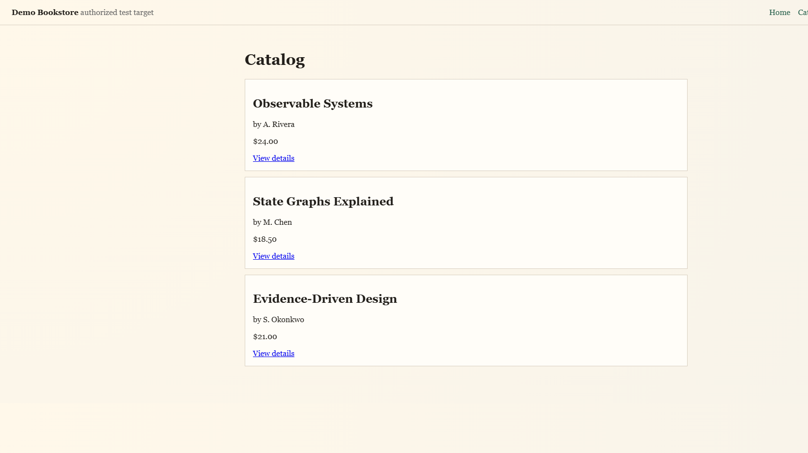

<p align="center">
  
</p>

<p align="center">
  <strong>Map what you can observe. Confirm what you infer. Rebuild what you own — independently.</strong>
</p>

<p align="center">
  <a href="#quick-start">Quick Start</a> ·
  <a href="#product-tour">Product Tour</a> ·
  <a href="#why-teams-choose-reverseforge">Why Teams Choose Us</a> ·
  <a href="#feature-universe">Features</a> ·
  <a href="#business-impact--time-savings">ROI</a> ·
  <a href="#security--trust">Security</a>
</p>

<p align="center">
  
  
  
  
</p>

---

# REVERSEFORGE AI

**REVERSEFORGE AI** is a production-oriented SaaS platform for **authorized** application reverse-engineering, behavioral analysis, specification recovery, and **independent** reconstruction.

Give it evidence you are allowed to use — a public or owned website, screenshots, API specs, schemas, repos, or design files — and it helps your team:

1. **Explore** the in-scope experience safely  
2. **Map** screens and workflows as a state graph  
3. **Infer** domain models and APIs with explicit uncertainty  
4. **Review** every critical claim with humans in the loop  
5. **Generate** a clean, independent implementation (first target: Next.js + FastAPI + PostgreSQL)  
6. **Export** a reproducible project ZIP with docs, migrations, and tests  

> **Hard boundary:** We never claim access to unobservable source code, private databases, secrets, or proprietary algorithms. Every important claim is classified as `OBSERVED`, `INFERRED`, `USER_CONFIRMED`, or `UNKNOWN`.

---

## Why teams choose REVERSEFORGE

| Pain today | What REVERSEFORGE unlocks |
|---|---|
| Legacy app, missing docs, original vendors gone | Recover an evidence-backed behavioral map and proposed SRS |
| Migration / rewrite without reliable specs | Turn observed workflows into reviewable domain + API proposals |
| Acquisition diligence on a product you can lawfully inspect | Structured inventory of screens, flows, gaps, and risks |
| Design-to-build handoff from UI evidence only | Independent UI + backend scaffold — not a brand/asset clone |
| Manual discovery eating weeks of senior time | Automated exploration + claim review instead of tribal walkthroughs |
| “AI hallucinated the schema” risk | Provenance, confidence scores, and explicit UNKNOWN fields |

<p align="center">
  
</p>

---

## Product tour

### Landing — clear promise, authorization-first posture

<p align="center">
  
</p>

### Sign in — multi-tenant workspace access

<p align="center">
  
</p>

### Dashboard — projects ready for analysis

<p align="center">
  
</p>

### Project wizard — scope, allowlists, budgets, authorization declaration

<p align="center">
  
</p>

### Analysis workspace — states, transitions, claims, domain model, export

<p align="center">
  
</p>

### Bundled demo target — safe bookstore app used for deterministic demos

<p align="center">
  
</p>

**Live acceptance snapshot (bundled demo):** 8 screen states · 44 transitions · 3 inference claims · 3 proposed entities · export ZIP produced · cross-tenant access denied (404).

---

## Business impact & time savings

These ranges are planning estimates for teams doing rewrite / migration / documentation recovery work. Actual savings depend on app size, auth complexity, and review rigor.

| Workstream | Typical manual effort | With REVERSEFORGE-assisted flow | Opportunity |
|---|---|---|---|
| Screen & navigation inventory | 3–10 days | Hours for in-scope crawl + review | Stop spreadsheet archaeology |
| Workflow / state mapping | 1–3 weeks | Same-day draft graph from exploration | Shared source of truth |
| Draft domain model & API sketch | 1–2 weeks | Hours → reviewable INFERRED model | Faster architecture workshops |
| Baseline SRS / handoff pack | 1–4 weeks | Generated draft + evidence links | Less “docs from memory” |
| Greenfield scaffold (app shell, migrations, tests) | 3–10 days | Minutes for first supported stack | Engineers start on real product logic |
| Visual / functional regression baseline | Days of setup | Pipeline-ready export artifacts | Earlier QA feedback |

### What that means for the business

- **Compress discovery** from multi-week tribal knowledge sessions into a repeatable pipeline  
- **Reduce rewrite risk** by separating OBSERVED facts from INFERRED guesses before code is generated  
- **Protect legal/compliance posture** with authorization scopes, allowlists, budgets, and audit trails  
- **Accelerate delivery** by exporting an independent project instead of starting from a blank repo  
- **Improve onboarding** — new engineers read evidence-linked claims instead of guessing  
- **Enable parallel workstreams** — product, data, frontend, backend, and QA review the same workspace  

### Who gets the most value

- CTOs / VPs Engineering running legacy modernization  
- Migration & platform teams  
- Product ops / business analysts recovering process truth from UIs  
- Agencies rebuilding client systems under explicit authorization  
- Security-conscious orgs that need auditability, not “black-box magic”  

---

## Feature universe

### Available in the current vertical slice

| Area | Capability |
|---|---|
| **SaaS foundation** | Registration, login, organizations, roles (owner/admin/analyst/viewer), projects |
| **Authorization & scope** | Written declaration, domain allowlists, path prefixes, depth/page/time budgets, kill switch |
| **Exploration** | Playwright-powered crawl of authorized web targets; screenshot capture; fingerprinting |
| **State graph** | Screen states + transitions persisted (not just a flat page list) |
| **Inference & review** | Claims with classification + confidence; approve / reject / correct |
| **Domain proposals** | Entities, fields, proposed API endpoints marked INFERRED/OBSERVED |
| **Reconstruction** | Independent Next.js + FastAPI + PostgreSQL project generation |
| **Export** | Downloadable ZIP with README, provenance note, migrations sketch, smoke tests |
| **Security basics** | Tenant isolation, SSRF/private-IP blocking, audit events, out-of-scope skip logging |
| **Demo kit** | Bundled Demo Bookstore + seed user for zero third-party dependency demos |

### Platform opportunities (roadmap modules)

The architecture is designed so these can land without rewriting the core:

1. Multi-tenant administration & billing  
2. Evidence ingestion for screenshots, recordings, Figma, PDFs, OpenAPI, HAR, schemas, repos  
3. Visual design / token / component inference  
4. Forms, validation, error-state, and session-lifecycle analysis  
5. Authorized login / role-based path exploration (vaulted credentials — never in prompts/logs)  
6. Repository architecture analysis (Tree-sitter)  
7. Accessibility & responsive layout analysis  
8. Full SRS editor with change review  
9. Visual regression / screenshot-diff engine  
10. Functional & contract test generation  
11. Gap detection dashboards & human review queues  
12. Additional generation adapters (Laravel+Filament, Django, React Native, Flutter, …)  
13. Kubernetes hardening, OpenTelemetry dashboards, retention automation  
14. Mobile package static metadata analysis (authorized APKs/IPAs)  

See [`FEATURE_MATRIX.md`](FEATURE_MATRIX.md) for truthful implemented / partial / planned status.

---

## How it works

```text
Authorized evidence
        │
        ▼
 Scope & Safety Agent  ── allowlists, budgets, kill switch
        │
        ▼
 Browser Explorer      ── state nodes + transition edges
        │
        ▼
 Modeling Agents       ── domain / API / design claims
        │
        ▼
 Human review gate     ── approve · reject · correct
        │
        ▼
 Generation adapter    ── independent app (Next + FastAPI + PG)
        │
        ▼
 Export ZIP            ── code · docs · migrations · tests
```

Durable pipeline stages **A → O** checkpoint in PostgreSQL so workers can resume after restart without losing completed stages.

---

## Quick start

### Prerequisites

- Docker Desktop / Compose v2+  
- (Optional) Node 20+ and Python 3.12+ for local package development  

### Run

```bash
cp .env.example .env
docker compose up --build -d
```

| Service | URL |
|---|---|
| Web UI | http://localhost:3000 |
| API + OpenAPI | http://localhost:8000/docs |
| Demo Bookstore | http://localhost:3100 |

Demo login (seeded automatically):

```text
owner@example.com
DemoOwner!234
```

### Acceptance demo

```bash
python scripts/acceptance_demo.py
```

Expected: exploration results, claim review, export ZIP, cross-tenant denial.

---

## Repository map

```text
apps/web/            Next.js SaaS UI
apps/api/            FastAPI + migrations + RBAC
apps/demo-target/    Bundled authorized demo web app
workers/             Celery exploration / modeling / generation
packages/            Shared / AI / exploration / generation packages
docs/                PRD, SRS, threat model, ADRs, screenshots
infra/k8s/           Deployment sketches
tests/               Integration & e2e harnesses
examples/            Deterministic demo evidence
scripts/             Acceptance & ops scripts
```

---

## Security & trust

- Authorization declaration required before scoped exploration  
- Domain / path allowlists and exploration budgets  
- Private-network / SSRF protections (trusted demo hosts only for local Compose)  
- Tenant isolation on analysis resources  
- Credentials as vault references only — never in prompts, logs, screenshots, or generated code  
- No CAPTCHA bypass, stealth evasion, credential harvesting, exploit development, or DRM circumvention  
- Generated apps use independent branding — proprietary assets are not auto-copied  

Details: [`SECURITY.md`](SECURITY.md) · [`docs/THREAT_MODEL.md`](docs/THREAT_MODEL.md)

---

## Documentation

| Doc | Purpose |
|---|---|
| [`AGENTS.md`](AGENTS.md) | Agent operating contract |
| [`ARCHITECTURE.md`](ARCHITECTURE.md) | System design |
| [`FEATURE_MATRIX.md`](FEATURE_MATRIX.md) | Implemented vs planned truth table |
| [`docs/PRD.md`](docs/PRD.md) | Product requirements |
| [`docs/SRS.md`](docs/SRS.md) | Software requirements |
| [`docs/DATA_MODEL.md`](docs/DATA_MODEL.md) | Persistence model |
| [`docs/API_SPEC.md`](docs/API_SPEC.md) | HTTP API overview |
| [`docs/WORKFLOW_ENGINE.md`](docs/WORKFLOW_ENGINE.md) | State-graph exploration |
| [`docs/AI_ORCHESTRATION.md`](docs/AI_ORCHESTRATION.md) | Agent orchestration |
| [`docs/DEPLOYMENT.md`](docs/DEPLOYMENT.md) | Deploy notes |
| [`docs/ROADMAP.md`](docs/ROADMAP.md) | Implementation roadmap |
| [`docs/adr/0001-platform-foundation.md`](docs/adr/0001-platform-foundation.md) | Foundation ADR |

---

## Tech stack

- **Web:** Next.js, TypeScript, Tailwind CSS  
- **API:** FastAPI, SQLAlchemy, Alembic, PostgreSQL  
- **Jobs:** Redis + Celery durable workers  
- **Exploration:** Playwright  
- **Artifacts:** Local export volume (S3/MinIO-ready design; Compose uses filesystem when object-store images are unavailable)  
- **Local orchestration:** Docker Compose · **Prod sketch:** Kubernetes manifests  

---

## Testing

```bash
# API unit tests
docker compose exec api pytest -q

# Live-stack integration
pytest tests/integration/test_api_flow.py -q

# Web smoke
docker compose exec web npm test

# Full acceptance path
python scripts/acceptance_demo.py
```

---

## What success looks like

A user can:

1. Sign up / sign in  
2. Create a project with an authorized target + scope  
3. Analyze the bundled demo (or another approved in-scope site)  
4. Inspect screen states, transitions, and evidence-linked claims  
5. Approve proposed domain assumptions  
6. Generate an independent application project  
7. Download a reproducible ZIP  

…with real persistence, tenant isolation, and honest claim classifications.

---

## Contributing posture

- Prefer working vertical slices over decorative mockups  
- Update `FEATURE_MATRIX.md` when status changes  
- Never disable security controls to make a demo pass  
- Keep OBSERVED / INFERRED / USER_CONFIRMED / UNKNOWN distinctions visible in UI and data  

---

## Author

**Imran Ahmed**  
Email: [me@imrandev.bd](mailto:me@imrandev.bd)  
Website: [https://imrandev.bd](https://imrandev.bd)  
Contact: [https://imrandev.bd/contact](https://imrandev.bd/contact)

## License

Proprietary — all rights reserved unless otherwise stated in package manifests.

---

## 🤝 Let's Connect & Collaborate

I am open to **Senior Remote Full-Stack Roles**, **AI Platform Architecture Contracts**, and **Enterprise Technical Advisory**.

**Timezone:** UTC+6 (Dhaka / Rangpur, Bangladesh) — Flexible overlap with US, UK, and European business hours.  
**Delivery Mode:** Async-ready, Slack, Discord, Jira, GitHub, and production-first accountability.

| Channel | Address / Handle | Quick Action |
|---|---|---|
| 📬 Contact Page | [imrandev.bd/contact](https://imrandev.bd/contact) | [Contact ↗](https://imrandev.bd/contact) |
| 🌐 Primary Portfolio | [imrandev.bd](https://imrandev.bd) | [Visit Site ↗](https://imrandev.bd) |
| 📦 Packagist Packages | [packagist.org/packages/imrandevbd/](https://packagist.org/packages/imrandevbd/) | [View Packages ↗](https://packagist.org/packages/imrandevbd/) |
| 💼 LinkedIn Profile | [linkedin.com/in/imranbru99](https://www.linkedin.com/in/imranbru99) | [Connect ↗](https://www.linkedin.com/in/imranbru99) |
| 🐙 GitHub Profile | [github.com/imranbru99](https://github.com/imranbru99) | [Follow ↗](https://github.com/imranbru99) |
| 💬 WhatsApp Direct | +880 1576-918420 | [Chat Now ↗](https://wa.me/8801576918420) |
| 📧 Direct Email | [me@imrandev.bd](mailto:me@imrandev.bd) | [Send Email ↗](mailto:me@imrandev.bd) |
| 🐦 X (Twitter) | [@imrandev_bd](https://x.com/imrandev_bd) | [Follow ↗](https://x.com/imrandev_bd) |
| 📺 YouTube Tech | [@ImranDevBD](https://www.youtube.com/@ImranDevBD) | [Subscribe ↗](https://www.youtube.com/@ImranDevBD) |

---

<p align="center">
  <strong>REVERSEFORGE AI</strong><br/>
  Authorized analysis. Evidence-backed inference. Independent reconstruction.<br/>
  <sub>Built by <a href="https://imrandev.bd">Imran Ahmed</a> · <a href="https://imrandev.bd/contact">Contact</a> · <a href="mailto:me@imrandev.bd">me@imrandev.bd</a></sub>
</p>
